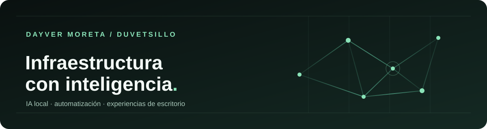

# Hola, soy Dayver

**Estudiante de Ingeniería de Sistemas. Construyo herramientas de IA local, automatización y software que conecta el homelab con el escritorio.**

Me interesa que la tecnología útil también se sienta bien al usarla. Por eso trabajo de extremo a extremo: infraestructura, modelos, interfaces y los detalles que unen todo.

[Ver proyectos](#proyectos) · [Explorar mi portafolio](https://github.com/Duvetsillo/Portfolio) · [Contactar](#contacto)

## Proyectos

### [Karen Desktop Pet](https://github.com/Duvetsillo/karen-desktop-pet)

Una presencia holográfica para el escritorio Windows y una interfaz autoalojada para navegador. Conecta con **tu propio OpenClaw Gateway** y convierte estados, conversación y voz en una experiencia visible. El cliente de Windows usa Electron; el servidor funciona con Node y Docker.

### [Aetherion · Local AI Benchmark](https://github.com/Duvetsillo/local-ai-benchmark)

Herramienta para comparar modelos locales según el hardware y la tarea. Descubre modelos de Ollama, mide el equipo, ejecuta pruebas reproducibles y guarda resultados JSON. Incluye cliente de escritorio con Qt 6 y un panel local.

### [KAREN Assistant](https://github.com/Duvetsillo/Karen-assitant)

Mi primer asistente local en Python. Explora lenguaje natural, automatización de rutinas y contexto de conversación. Es el punto de partida de los experimentos que hoy continúo en Karen.

### [Portafolio](https://github.com/Duvetsillo/Portfolio)

Una vista más amplia de mi trabajo en IA local, infraestructura y experiencias interactivas.

## Lo que une mi trabajo

- **IA en hardware propio:** Ollama, pruebas de modelos y herramientas que priorizan el control local.
- **Interfaces con carácter:** aplicaciones de escritorio y web donde la claridad importa tanto como la función.
- **Infraestructura autoalojada:** Linux, Docker, redes, servidores y automatización del hogar.

## Herramientas que uso

`Python` · `TypeScript` · `JavaScript` · `Electron` · `Qt / PySide6` · `Docker` · `Linux` · `Ollama` · `OpenClaw`

## Contacto

[LinkedIn](https://www.linkedin.com/in/dayver-moreta-501771419/) · [Correo](mailto:Dayvermoreta21@gmail.com) · [Portafolio](https://github.com/Duvetsillo/Portfolio)

Building local AI tools, self-hosted systems and expressive desktop experiences.
